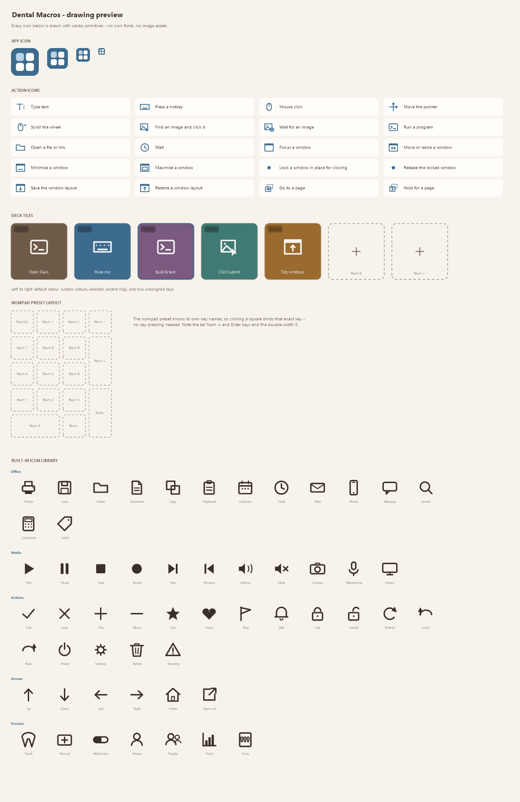

# Dental Macros

> **Formerly MacroDeck.** Upgrading keeps your macros. The installer updates
> the existing install in place; for the portable copy, put the new files in
> your old folder and delete `MacroDeck.exe`. Either way, "run at sign-in"
> carries over to the new name.

A **Stream Deck–style macro app for Windows**, written in C++ with no runtime
dependencies. It turns a spare keyboard or numpad into a grid of macro keys
you configure by pointing and clicking.

The trick that makes it work: Windows' Raw Input API reports *which physical
keyboard* every keystroke came from. So Dental Macros can swallow every key on
your macro pad — firing macros instead of typing — while your main keyboard
keeps behaving completely normally.

This is a C++ fork of the Python `macrokb` tool in the `Macros` folder. It has
the same engine but a real graphical deck instead of a form-based editor, and
it drops the Python and OpenCV dependencies entirely.



---

## Before you start: Smart App Control

Smart App Control **may** refuse to run Dental Macros. Where it does, you'll see:

> This command cannot be run due to the error: An Application Control policy
> has blocked this file.

**The way to find out is to run it.** Build the app, launch
`build\DentalMacros.exe`, and see what happens. If the window opens, nothing here
applies to you and you can skip to the next section.

Don't use the registry to predict it:

```bash
powershell -c "(Get-ItemProperty 'HKLM:\SYSTEM\CurrentControlSet\Control\CI\Policy').VerifiedAndReputablePolicyState"
```

`0` = off, `1` = on and enforcing, `2` = evaluation mode. A `1` does **not**
mean you're blocked. This has been verified on a PC reporting `1` where
Dental Macros launches, runs and exits perfectly normally — and where a build
copied from a machine that *was* blocked runs equally well. The same
unmodified executable can be refused on one PC and fine on the next, so treat
this value as a clue about why a block happened, not as a forecast that one
will.

**The verdict is per-file, and it is a fresh roll of the dice for every
build.** On one PC reporting `1`, one build of Dental Macros was refused while
another build of the same source, minutes apart, ran perfectly. Copying the
refused file elsewhere did not help; rebuilding it did. So if a build is
blocked:

- **Just build again.** Every link stamps a new timestamp into the executable,
  so `build.bat` produces a different file and gets judged afresh. This is the
  cheapest thing to try and it often works.
- If you plan to hand this to anyone else, that unpredictability is the reason
  to sign it — see the options below.

If you are blocked, it isn't a bug and isn't a false positive to argue with.
Smart App Control blocks *unsigned* programs that install a low-level keyboard
hook — exactly what any macro tool, including this one, has to do to stop your
macro pad from typing into apps. A commercial tool avoids the block by paying
for a code-signing certificate and building up reputation with Microsoft. Your
options, least drastic first:

- **Try it on another PC.** Since the block travels with the machine and not
  the file, this costs nothing and often just works.
- **Keep using the Python `macrokb`** in the `Macros` folder instead. Scripts
  aren't subject to this check because `python.exe` is already signed and
  trusted, so the Python version runs on a machine where this one won't.
- **Turn Smart App Control off** — Windows Security → App & browser control →
  Smart App Control settings → Off. **This is a one-way door:** Windows will
  not let you switch it back on without a full reset of the PC. Weigh that
  before doing it; it is a real reduction in your machine's protection, and
  the two options above cost you nothing.

The official releases on the
[Releases page](https://github.com/SMEdevelop/DentalMacros/releases) are not
signed yet either (see [Code signing policy](#code-signing-policy)), so Smart
App Control can refuse them the same way.

Everything except launching the app works regardless — the build and the full
test suite run fine.

---

## Building

You need the Microsoft C++ compiler (MSVC). If you don't have it:

```bash
winget install Microsoft.VisualStudio.2022.BuildTools --override "--quiet --add Microsoft.VisualStudio.Workload.VCTools --includeRecommended"
```

That is the compiler only — no Visual Studio IDE. `build.bat` finds it by
itself through `vswhere`, so there is no need to open a Developer Command
Prompt first:

```bash
build.bat
```

The result is `build\DentalMacros.exe`.

**It is not a single file any more.** As of beta 0.7 Dental Macros is built with
MSVC and links the C++ runtime dynamically (`/MD`), so the executable needs
three DLLs beside it:

| DLL | |
|---|---|
| `msvcp140.dll` | C++ standard library |
| `vcruntime140.dll` | compiler runtime |
| `vcruntime140_1.dll` | exception handling |

Running `build\DentalMacros.exe` straight out of `build\` works on the machine
that built it, because Visual Studio put those DLLs in `System32`. **That is
exactly why a broken package looks fine here and fails on someone else's PC.**
Do not hand anyone the bare .exe — use `package.bat`, which copies the three
DLLs in beside it. The zip and the installer it produces both carry them, and
need nothing preinstalled on the target machine beyond Windows 10/11 itself.

(The 1.0.0 release was built with GCC and `-static`, which did produce one
self-contained file. The trade is deliberate: MSVC matches the platform it
targets, and the packaged download is self-contained either way.)

Settings live next to the .exe - unless that folder can't be written, in
which case they go to `%LOCALAPPDATA%\DentalMacros` instead (see
[Settings file](#settings-file)).

To check everything works on your machine:

```bash
run_tests.bat
```

This runs 510 checks covering JSON, the config model, pages and their
application rules, mice and the wheel, the step engine, key tables, deck
presets, window management, the image matcher, config recovery, the
recorded-click workflow, and importing a macrokb `macros.yaml`. The engine
tests only run steps with no side effects — nothing is typed, clicked or
launched, and the window tests drive a throwaway window of their own.

---

## Quick start

The first time Dental Macros opens, a short setup makes your first button:

1. **Welcome** - two questions: buttons on your screen or on a keypad, and
   whether the first one types something or clicks through screens.
2. **Checking** - plain checks with a tick each: your settings can be saved,
   your keypad can be read, the emergency off switch works, and any dental
   programs it finds (with a warning for one running as administrator, which
   would ignore typing and clicks). For a keypad: press any key on it, and
   that key becomes your first button.
3. **Your first button** - type what it should type, or record the clicks;
   give it a name; choose whether Dental Macros starts with Windows.

You land in Simple mode with the button selected and ready to press. Setup is
offered once; **Skip setup** leaves you to it, and **Settings → Run setup
again** brings it back. A keypad set up this way gives up only the keys that
carry a button; its other keys keep typing until you give them buttons too.

To set things up by hand instead (in Advanced mode):

1. Plug in the keyboard or numpad you want to dedicate to macros.
2. Run `build\DentalMacros.exe`, skip setup, and click **Add a keyboard**.
3. Pick your macro keyboard from the list and give it a name.
   - Not sure which entry is which? Click **Identify by pressing a key** and
     press a key on the pad — the matching entry highlights itself.
   - By default, whichever keyboard you choose stops typing into your apps
     while Dental Macros is listening — so pick the *spare* one. If you'd rather
     put macros on F13–F24 or extra keys of the keyboard you actually type on,
     see [Keeping the rest of the keyboard](#keeping-the-rest-of-the-keyboard)
     below; you can give up only the macro keys instead.
4. Choose a deck layout (top of the deck area). If you're using a numeric
   keypad, pick **Numeric keypad** and you get a keypad-shaped grid.
5. Click a key on the grid, then **Add step** — or drag an action straight
   from the left-hand list onto a key.
6. Click **Start Listening**.

"Listening" is the state where Dental Macros is watching your macro keyboard: its
keys fire macros, and — for any keyboard with *Block these keys from apps*
ticked — they stop typing into your apps. Everything else in the app works
whether or not it is listening; you can build and test macros with it off. The
line under the title always says which state you are in and what it means.

### Keeping the rest of the keyboard

Right-click a keyboard in the sidebar and you get two related options:

| Option | What it does |
|---|---|
| **Block these keys from apps** | Whether this keyboard gives up *anything*. Untick it and macro keys fire *and* type — useful for testing. |
| **Turn off all normal input, not just macro keys** | Only matters when the first is ticked. **Ticked** (the default): the whole keyboard goes silent — right for a dedicated macro pad. **Unticked**: only the keys that actually run a macro stop typing; every other key on that keyboard works normally. |

Untick the second one when your macro keys are F13–F24, extra keys, or
anything else on a keyboard you also type on. You keep the whole keyboard and
lose only the keys you deliberately bound.

A key with a tile but no steps yet is *not* treated as a macro key, so a
half-built binding never silently swallows a key.

The sidebar shows a small badge for anything other than the default: `pass`
when the keyboard gives up nothing, `some` when it gives up only its macro
keys, `click` for software buttons with no keyboard behind them. A keypad's
dot is green while Windows can see it and grey while it is switched off,
asleep or unplugged; the status line says when one goes or comes back, and
its keys work again on their own as soon as it does. New keyboards
take their starting values from **Settings → Keypads → New keypads**, and
this option applies the moment you change it — unlike the
first one, it needs no stop-and-start.

Settings save themselves as you work, and the previous day's file is kept in
`backups\` the first time each run saves.

**Ctrl+Alt+Shift+M starts and stops listening from anywhere in Windows**, so a
pad that has stopped typing can always be handed back without finding the
window. The Stop button spells the shortcut out while it is listening. Change
or clear it under **Settings → Keypads → Emergency off switch**.

### What blocking costs the keyboard you type on

Worth understanding before you put macros on your **main** keyboard.

Blocking is done with a Windows low-level keyboard hook, and that hook is
**global and synchronous**: every keystroke from every keyboard in the machine
goes through Dental Macros before the program you are typing into sees it. To
decide whether a key belongs to a macro pad, Dental Macros has to work out which
physical keyboard it came from, and that means waiting briefly for the
matching raw-input event. Measured here, a keystroke that cannot be matched
stalls for about **40ms** before being let through.

On a dedicated macro pad that costs nothing you would notice. On the keyboard
you type on all day it is a different story, and if enough keystrokes queue up
Windows eventually decides the hook is too slow and stops calling it — which
looks exactly like dropped keystrokes.

So Dental Macros asks a cheaper question first: *could any keyboard here possibly
block this key at all?* If the answer is no — and with a handful of macros on
a keyboard set to take only the macro keys, that is very nearly every key you
type — the keystroke goes straight through with no waiting and no lookup. The
answer is worked out whenever the configuration changes, so the hook does a
flat table read and nothing else.

Two cases must still be paid for, because there is no honest shortcut:

- keys that **actually run a macro** on a blocking keyboard, and
- **every** key on a keyboard set to *Turn off all normal input*, since the
  point is that the whole device goes silent, and only the device itself can
  tell you which keyboard a keystroke came from.

If your main keyboard still feels slow, the options in order of how little you
give up: untick **Turn off all normal input** so only bound keys are
inspected; move the macros to **software buttons** (below), which install no
hook at all; or untick **Block these keys from apps**, which means macro keys
fire *and* type.

### Buttons with no keyboard

**＋ Add software buttons** in the sidebar makes a deck with no keyboard
behind it. The buttons live on the deck and on the always-on-top palette, and
you fire them by clicking. There is no key to press, nothing is taken from
anything you type, and **no hook is installed** — so this cannot cost a
keystroke anywhere in Windows, however many buttons you make.

It is the right answer when you want macros but not at the price of touching
your typing, when the macro pad is not plugged in, or when there is no spare
keyboard to dedicate to the job.

They need no **Start Listening**: a click is not a keystroke, so there is
nothing to intercept. If software buttons are all you have configured,
Dental Macros does not register for raw keyboard input at all, and says so in the
activity log rather than claiming to be listening to something.

Everything else about them is an ordinary binding — label, icon, colour,
steps, Test run, and firing from the always-on-top palette.

### Bluetooth keypads

A Bluetooth keypad is added with **＋ Add a keyboard** like any other. A
Bluetooth LE keypad is listed under the name it was paired with.

Windows splits a keypad into several inputs: its keys, its media keys, often a
mouse, sometimes a dial. Dental Macros matches a Bluetooth LE keypad by its
address, which all of those inputs share, so one deck hears every button the
keypad has. Many of those extra buttons are not keys at all but **media keys**,
and those can carry a macro too:

| Name | |
|---|---|
| `volumeup` `volumedown` `volumemute` | Volume. `mute` also works. |
| `mediaplay` `medianext` `mediaprev` `mediastop` | Play/pause and tracks. `playpause` also works. |
| `calculator` `mail` `thispc` `mediaselect` | Launcher keys. `calc` and `email` also work. |
| `browserback` `browserforward` `browserrefresh` `browserstop` `browsersearch` `browserfavorites` `browserhome` | Browser keys. |
| `zoomin` `zoomout` `brightnessup` `brightnessdown` `sleep` `power` | Media keys Windows has no key code for. |
| `consumer_0x###` | Any other media key, by its HID usage number — which is what pressing it records. |

The last two rows can be pressed and bound, but a macro cannot *type* one, and
blocking has nothing to act on: Windows makes no keystroke of its own out of
them, so there is nothing to take away from other programs.

Some keypads send one press as two, a few milliseconds apart. A press that
arrives within 40 ms of the same key's release is treated as that same press,
so its macro runs once.

What Dental Macros cannot do is tell apart two buttons that send exactly the same
thing. When two keys both send Alt, or a programmable key sends Win+4 (which
Windows acts on before anything else sees the 4), reassign them in the
keypad's own software — most keep the assignment in the keypad itself — to
keys nothing else sends, such as F13–F24.

### Mice and trackpads

A spare mouse can be a macro device exactly as a spare keyboard can. **＋ Add
a mouse or trackpad** in the sidebar scans pointing devices instead of
keyboards; everything after that is the same deck, the same steps, the same
pages.

It works because a mouse button already *has* a virtual key of its own that no
keyboard ever sends — `VK_LBUTTON` and friends — so above the device layer a
button is a key like any other. The wheel has no such code and is given four
out of the range Microsoft documents as unassigned. That is the whole trick:
nothing else in Dental Macros had to learn what a mouse is.

| Name | |
|---|---|
| `mouseright` `mousemiddle` | Right and middle. `rmb` / `mmb` also work. |
| `mouse4` `mouse5` | The thumb buttons. Also accepted as `mouseback` / `mouseforward`, which is what they usually do. |
| `mouse6` … `mouse20` | The extra buttons on a multi-button mouse, numbered the way its own software numbers them. |
| `wheelup` `wheeldown` | A notch of the wheel, in either direction. |
| `wheelleft` `wheelright` | Tilt, on a wheel that has it. |

`mouseleft` is missing from that list on purpose — see below.

A **Windows precision trackpad reports itself as a mouse**, so its clicks and
two-finger scrolling arrive here too. Multi-finger *gestures* do not — those
come through a different HID interface entirely, and Windows consumes most of
the standard ones before any program sees them. They are not supported.

**Left click cannot carry a macro.** Not on a spare mouse, not on any mouse.
A macro there would fire on every click you made anywhere, and if it were
blocked as well there would be no way left to click your way out of it — the
escape hatch for a runaway keyboard is that you can still type
Ctrl+Alt+Shift+M, and a pointer has no equivalent.

It is refused everywhere rather than in the editor only: the mouse deck has no
slot for it, assigning it is refused with an explanation, and a `macros.json`
that names it anyway — hand-edited, or carried over from an older build — has
that one binding dropped on load and says so in the activity log. The rest of
that deck loads normally.

This is a flat rule rather than a situational one, deliberately. Blocking can
afford to ask *how many pointers are attached right now*, because it decides
live. A binding is written into a file and read back on another machine, so a
config that was harmless where it was written and catastrophic where it was
opened would be worse than never allowing it.

Separately, and as a second line of defence, **the primary button is never
blocked while it is the only pointer** — asked of Windows rather than assumed,
since swapping your buttons swaps which virtual key is primary.

Two smaller deliberate choices. A mouse is added with blocking **on but not
greedy** — only the buttons carrying macros are taken — because a mouse whose
every button stopped working the moment you added it is a nasty surprise. And
the pointer hook is installed **only when a mouse is actually configured to
block something**: it sees every movement in the machine, and a setup with no
macro mouse should never pay for one.

#### Buttons past the fifth

**Windows' mouse packet only ever reports five buttons.** That is a limit of
Raw Input, not of Dental Macros, and it is why a twelve-button mouse does not
simply appear as twelve buttons.

What those extra buttons actually do varies by manufacturer, and there are
three cases:

- **They send keystrokes.** Very common — the mouse presents a second,
  keyboard-shaped endpoint, and its own software maps the side panel onto
  key combinations. Add that endpoint with **＋ Add a keyboard**; it appears
  in the list under the mouse's own name. This works today and needs nothing
  special.
- **They arrive as HID buttons on a second collection.** Dental Macros registers
  for these and reads the Button usage page out of the report, so buttons 6
  to 20 come through as `mouse6` … `mouse20`. Buttons 1–5 are ignored there,
  since the ordinary mouse packet already reported them and firing every
  macro twice would be worse than not supporting them at all.
- **They are vendor-defined and only its own driver understands them.**
  Nothing generic can read those. Map them to keystrokes in the vendor
  software and use the first case.

Note that the HID path can *trigger* a macro but cannot **block** the button:
the low-level mouse hook only sees the five Windows knows about. In practice
that costs little, since a button past the fifth usually does nothing in most
applications anyway.

**Untested against real hardware.** There is no multi-button mouse on the
machine this was written on, so the HID reading is implemented to spec and
covered by unit tests, but it has not been proved against an actual side
panel. If yours does not light up, say so and it can be diagnosed against the
device.

### The wheel as a dial

A grid of buttons is bad at exactly one thing: a value you want *more* or
*less* of. Volume, brush size, a timeline. That is what the dials on a
Loupedeck or a TourBox are for, and any wheel you already own can do it.

Every tile carries three things rather than one. The inspector has
**Press / Wheel ↑ / Wheel ↓** above the step list; pick one and every button
below — add, edit, reorder, test, copy and paste — acts on that list.

Then **scroll the wheel over the tile**, on the deck or on the
always-on-top palette, and that direction runs. A tile with anything bound to
its wheel is marked with a small pair of chevrons, so a dial is not a feature
you have to know about to find. A dial with nothing on its press is finished,
not half-built, and says *scroll to use* rather than *no steps yet*.

The deck stops scrolling under you while you turn a dial: a notch spent on a
tile is not also spent on the list behind it.

---

## The interface

### Simple and Advanced

The **Simple | Advanced** switch at the top changes what the window shows,
never what is saved. A new setup starts in **Simple**; a settings file from an
earlier version opens in **Advanced**, so upgrading changes nothing.

Simple mode is for making buttons that do four things: **type text**, **press
keys** (a shortcut such as Ctrl+S), **record clicks**, and **wait**. A
button's steps are listed in plain words - *Type "Thank you for visiting…"*,
*Press Ctrl+S*, *Click in Opendental (3 clicks)*, *Wait 1 second* - and a
whole recorded click sequence is one row: double-click it to record it again,
or remove it in one go. Double-click any other row to change it. There are no
icons, pages to make, mice, dials, drag-and-drop palette or activity log; the
status line at the bottom stays.

Steps that Simple mode doesn't make are never hidden or lost. They show as
**+ 2 advanced steps** - double-click that row to switch to Advanced with them
selected. A deck that already has several pages still shows its page tabs in
Simple mode, so a page changing by itself is never a mystery.

Everything below describes Advanced mode.

**Left sidebar** — your macro keyboards, and the palette of actions. Drag any
action onto a key to add it as a step.

**Middle — the deck.** A strip of [pages](#pages) along the top, and below it
one tile per key. Each tile shows its key name, an icon, and the label you
give it. Tiles light up green for a moment when their key fires, so you can
see at a glance that the pad is being read correctly.

- **Click** an empty tile to assign a key to it
- **Click** a configured tile to select and edit it
- **Double-click** to rename
- **Right-click** for icon, colour, test run, duplicating the key, copying and
  pasting its steps, and removal
- **Scroll** when a deck has more keys than fit

**Right — the inspector.** The label, icon and colour for the selected key,
plus its list of steps with add / edit / remove / reorder and **Test run**.

Click a step to select it; **double-click** it to open the editor. A selected
step stays selected while you edit, delete or move it, so a run of changes
does not need a re-click between each one.
**Record clicks...** builds a click sequence for you. Dental Macros steps out
of the way and a small recorder window stays on top in the corner of the
screen. **Right-click** each spot you want clicked, in order; each one is
listed in the recorder and marked on screen with its number. Right-click
twice quickly on the same spot to record a **double-click**.

Made a mistake? **Undo last** takes back the newest click, **Remove** drops
the one selected in the list, and **Redo this spot** makes your next
right-click replace the selected one. **Fast / Normal / Slow** sets the pause
between clicks (0.2, 0.5 or 1.5 seconds). Nothing is added to the key until
you press **Done**; **Cancel** asks before throwing clicks away. Each click
becomes a `click` step, with a `sleep` step between clicks; edit any of them
afterwards like any other step.

Right-click, not left, so that **left click keeps working normally while you
record**. You can open the tab, menu or dialog the recorded click needs to
land on, then right-click the target. The right click is swallowed, so no
context menu opens over the thing you are recording — which does mean you
can't open a context menu with the mouse mid-recording; use the **Menu** key
or **Shift+F10** if the spot you want is inside one.

It also **locks the sequence to the window you clicked first**. See
[Why recorded clicks keep working](#why-recorded-clicks-keep-working) — this
is what makes a recorded sequence still work tomorrow.

**Bottom — activity log.** Every macro that fires, and the exact reason for
anything that fails. Beside the **Activity** heading, one line says the latest
news in plain words: a button that ran, or which button stopped, at which
step and why — "OpenDental isn't open", "the picture it looks for isn't on
screen". When the window is closed to the notification area, a button that
stops shows a notification instead.

### Icons

**Icon...** in the inspector opens a library of 55 built-in icons — Office,
Media, Actions, Arrows and Practice — and **Browse for an image file...**
inside it is still there if you would rather use a picture of your own.

They are drawn in code rather than shipped as image files, for the same
reason the action glyphs are: nothing to install beside the executable,
nothing to lose when the folder is moved, identical on every machine, and
crisp at any size from a 30-pixel launcher button to a full-size deck tile.

A library icon is stored as `"icon": "lib:printer"`. Anything without the
`lib:` prefix is still read as a file path, so decks built before the library
existed keep working exactly as they did.

### Buttons on top of everything

The deck above is an editor. The other half is a launcher: a small window of
just the buttons that stays on top of whatever you are working in, so a macro
can be fired with the mouse when the pad is out of reach — or not plugged in
at all. Open it with **Show floating buttons** at the top of the main window,
or from the notification-area icon when the main window is closed.

Each button is 38 pixels by default, smaller than a desktop icon, and the
whole thing is about the size of a large tooltip. **Drag the strip along the
top** to move it anywhere; there is no title bar. The **✕** at the right of
that strip puts it away.

- **Left-click** a button to run its macro. It works whether or not the
  engine is listening, because clicking one is not a keystroke that needs
  intercepting.
- **Right-click** anywhere on it for **button size** (small / medium /
  large), **buttons per row** (2 to 10), and a way back to the main window.
- **Hover** a button and its full label appears in the top strip. There is no
  room for a long label on a 38-pixel square, so it goes where it can be read.
- Buttons **flash green** when they run, whether you clicked them here or
  pressed the key on the pad.

Two deliberate details. It **never takes focus**: a macro that types or
clicks acts on whatever window is in front, so a palette that grabbed the
foreground on the way to firing one would send the whole macro to itself. And
it stays **out of the taskbar and Alt-Tab**, where a window this size has no
business appearing.

Where it sits, how big it is and whether it was open are remembered in
`macros.json` and restored next launch — including on a second monitor left
of the primary one, where the coordinates are negative. If that monitor is
gone, it comes back on one that still exists rather than off in the void
where a window with no title bar could not be dragged home.

It shows the keys of the **selected keyboard**. One keyboard's worth of
buttons is what fits in a window this size, and guessing between several pads
would be worse than following the one already on screen behind it.

When that keyboard has more than one [page](#pages), a thin bar appears under
the grip strip: `‹ Design 2/3 ›`, with the page's colour as a line beneath the
name. The arrows move between pages and wrap round at each end, since on a
strip this narrow an arrow that does nothing is just a dead spot. With one
page the bar is not there at all and costs no height.

### Deck layouts

| Layout | What it's for |
|---|---|
| Auto | Grows as you add keys. Good for any keyboard. |
| 3×2, 3×3, 4×3, 5×3, 8×4 | Fixed grids matching common macro pads. |
| Numeric keypad | Real keypad shape — the tall `+` and `Enter`, wide `0`. |
| Function keys F1–F12 | Two rows of six. |
| Mouse buttons | Laid out like a mouse — thumb buttons at the sides, wheel down the middle. |

The numpad and F-key layouts already know their key names, so clicking an
empty square binds that exact key with no key-pressing needed. On the blank
grids, clicking an empty square asks you to press the key you want there.

### Pages

The strip above the deck is its pages. Each one is a **complete set of
bindings for the same keys**, so twelve buttons on four pages are
forty-eight macros, and `num1` can be *Cut* on one page and *Crop* on the
next. Every deck has one page until you press **+**; nothing changes for a
setup that never uses them.

- **Click** a page to switch to it
- **Double-click** to rename
- **Right-click** for its colour, its application rule, duplicating,
  reordering and removal

A page's colour is what tells you which one you are on without reading -
the same job the RGB backlight does on a hardware macro pad. It tints the
page's own tab and the palette's page bar.

Two actions let a key on the pad move between them, so pages work with the
pad in your hand and not only from this window:

| Action | |
|---|---|
| **Go to a page** | By name, or next / previous / back to the default. |
| **Hold for a page** | Only while the key is held. Let go and you are back where you were - what the touch strip does on a Creator Micro. |

**Blocking looks at every page, not just the one in front.** A key that
carries a macro anywhere is taken from other programs everywhere. What a key
*does* is allowed to change with the page; whether it reaches the application
underneath is not, because a key that types into your document on page two
and fires a macro on page three is worse than either answer on its own.

### A page per application

Right-click a page → **Show this page for an application...** and pick from
what is running. From then on that page comes to the front by itself whenever
that program does, and the deck goes back to the **default page** - the one
with no rule - when you move to anything else.

Where two pages could both claim a window, the **more specific rule wins**: a
page matched on `chrome.exe` *and* a title containing "GitHub" beats one
matched on `chrome.exe` alone. Where several are equally specific, the one
earliest in the strip wins, because page order is something you can see and
drag.

Three things make it liveable rather than infuriating:

- **A page you pick by hand stays put** until you move to a different
  application. Switching away the moment you touch it would be useless.
- **The padlock** at the right of the strip turns the whole thing off. Green
  and open means the deck follows what you are doing; grey and shut means it
  stays exactly where you left it. It is remembered in `macros.json` as
  `switchPageWithApp`.
- **Coming here does not count.** Dental Macros's own window taking focus is
  never treated as an application change, so a page cannot slide out from
  under you while you are editing it.

Matching uses the same three fields, with the same meanings, as
[Why recorded clicks keep working](#why-recorded-clicks-keep-working): exact
on the program and the window class, case-insensitive substring on the title.
Picking an application from the list fills in the **program** only -
deliberately, since adding the class would make the rule miss the moment that
program opened a different kind of window. Add a class or title by hand in
`macros.json` when you want a page for one document rather than one app.

---

## Actions

| Action | Notes |
|---|---|
| Type text | Unicode, layout-independent. Optional per-character delay. |
| Press a hotkey | e.g. `ctrl+shift+t`. **Record** captures a combo you press. |
| Mouse click | At a position, or wherever the pointer is. |
| Move the pointer / Scroll the wheel | |
| Find an image and click it | Waits for the picture, then clicks it. |
| Wait for an image | Pauses until something appears on screen. |
| Run a program | Any program or shell command. |
| Open a file or link | Anything with a default app, including URLs. |
| Wait | Pause between steps. |
| Focus / Move / Minimise / Maximise a window | By title, program, window class, or any combination. |
| Lock a window in place for clicking / Release it | Put a window back where recorded clicks expect it, then undo that. |
| Save / Restore the window layout | Snapshot every window, put them back later. |
| Go to a page | Switch this deck to another page, by name or direction. |
| Hold for a page | Show another page only while the key is held down. |

Steps run top to bottom. If one fails, the macro stops and the log says which
step and why — unless that step has **Keep going if this step fails** ticked,
in which case the failure is logged and the macro carries on.

Holding a macro key down runs its macro **once**, not once per keyboard
repeat.

### Image matching

**Snip...**, next to **Browse** on the picture field of "Find an image and
click it" or "Wait for an image", hides Dental Macros, dims the screen and
lets you drag a box around a button or icon. That PNG becomes the template the
step searches for.

Matching runs entirely on your machine using normalised cross-correlation over
an image pyramid — the same metric OpenCV's `TM_CCOEFF_NORMED` uses, but
implemented directly, so there is no OpenCV dependency. A full 2560×1440
search takes a few tens of milliseconds.

Tips:

- Snip something **distinctive** — the button itself, not the whole dialog. If
  you snip a blank area, Dental Macros refuses it and tells you why, rather than
  silently matching the wrong thing.
- Include detail in **both directions**. Matching ignores brightness and
  contrast, so a plain horizontal band — a toolbar edge, a divider line —
  matches equally well at *every* horizontal position, and the click can land
  anywhere along it. A patch with structure across *and* down pins the
  position exactly. Capturing the button's text or icon is usually enough.
- Avoid anything that changes: a clock, a caret, a progress bar.
- Templates are resolution-dependent. Re-snip if you change display scaling.
- If a match is missed, lower the confidence (0.75 is forgiving, 0.85 is the
  default, 0.95 is strict).

### Why recorded clicks keep working

A recorded click is an absolute screen position. That is only meaningful while
the window you were clicking is exactly where it was when you recorded — move
it, resize it, maximise it, and every click lands somewhere else. This is the
single reason click macros usually rot.

So when you record clicks, Dental Macros notes the **window** the first click
landed in — its class, its program, and its exact position and size — and
wraps the sequence in two extra steps:

| Step | What it does |
|---|---|
| **Lock a window in place for clicking** | Brings that window to the front, waits until it really is in front, remembers where it currently sits, un-maximises it if needed, moves it back to the size and position it had while you were recording, then pauses briefly so it can finish redrawing. |
| ...your clicks and waits... | |
| **Release the locked window** | Puts the window back exactly where it was — including re-maximising it if it was maximised — and gives your keyboard and mouse back. |

The window is matched by its **class**, which is fixed by whoever wrote the
program, rather than by its title, which changes with whatever document is
open. Recording also fills in the program name for good measure. Both are
ordinary fields you can edit or clear on the *Lock* step.

Nothing about this is magic, and all of it is visible: they are normal steps
in the step list. Delete them if you want the old behaviour of clicking at
raw screen positions, or add them by hand to a sequence you built yourself.

**Blocking input.** The *Lock* step can also block your keyboard and mouse for
the duration, so a stray nudge cannot derail the sequence. Windows only allows
a program to do that when it is **running as administrator** — otherwise the
request is refused. Dental Macros says so in the activity log rather than
pretending you are protected. Whatever happens, the block is always lifted
when the macro ends, including when a step fails part way through.

### Window layouts

A "Save the window layout" step records where every window is. "Restore a
window layout" puts them back — matching windows by program name and title
similarity, so it still works after the apps have been restarted.

---

## Coming from the Python macrokb

**Settings → Import from macrokb...** reads your existing config:
keyboards, key bindings, every step, and your settings. Nothing is
overwritten — imported keyboards are added alongside anything already set up,
and the original `macros.yaml` is not modified.

What changed in the fork:

| | macrokb (Python) | Dental Macros (C++) |
|---|---|---|
| Needs installed | Python + 4 packages | nothing |
| Editor | Forms and lists | Deck of tiles you click and drag |
| Image matching | OpenCV | Built in |
| Config | `macros.yaml` | `macros.json` (same ideas, adds tile icons/colours/layout) |
| Runs in tray | no | yes |
| Blocked by Smart App Control | no | on some PCs — see the top of this file |

Both read keyboards the same way, so device ids carry over unchanged.

---

## Settings file

`macros.json`, next to the executable - or, when Dental Macros can't write in
its own folder (a copy run from Program Files, a locked-down share or a
write-protected stick), in `%LOCALAPPDATA%\DentalMacros`. The first time
that happens, the settings, `images\` and `layouts\` are copied across;
nothing is ever copied over settings already there. The same move happens
mid-run if Windows starts refusing saves in the program's folder. Settings →
**Show my settings file** and the About box both say which folder is in use.
Pictures stored by relative path are looked for in that folder first, then
beside the program.

```json
{
  "settings": {
    "blockMacroKeyboards": true,
    "matchConfidence": 0.85,
    "layoutsDir": "layouts",
    "startEngineOnLaunch": true,
    "listenOnByDefault": true,
    "switchPageWithApp": true,
    "minimizeToTray": true,
    "startMinimized": false,
    "toggleHotkey": "ctrl+alt+shift+m",
    "miniDeckVisible": false,
    "miniDeckX": 1520,
    "miniDeckY": 820,
    "miniDeckTile": 38,
    "miniDeckCols": 5
  },
  "keyboards": [
    {
      "alias": "Numpad",
      "match": "VID_046D&PID_C53D",
      "block": true,
      "deck": "numpad",
      "bindings": [
        {
          "key": "num1",
          "title": "Open Slack",
          "color": "#3b82f6",
          "steps": [ { "do": "run", "cmd": "slack.exe" } ]
        }
      ]
    }
  ]
}
```

### Pages in the file

A deck that uses one plain page is written exactly as it always was, with
`bindings` straight on the keyboard - so an ordinary config stays readable by
a build from before pages existed, and a file written by one still loads here
as a deck with a single page. The moment a deck has a second page, a colour or
an application rule, it is written as `pages` instead:

```json
{
  "alias": "Buttons",
  "softwareOnly": true,
  "deck": "auto",
  "pages": [
    { "name": "General", "bindings": [ ... ] },
    {
      "name": "Design",
      "color": "#a855f7",
      "appRule": { "exe": "photoshop.exe" },
      "bindings": [ { "key": "num1", "title": "Crop", "steps": [ ... ] } ]
    }
  ]
}
```

A deck on a pointing device carries `"device": "mouse"`, and any binding may
carry `scrollUp` and `scrollDown` beside its `steps`:

```json
{
  "alias": "Spare mouse",
  "device": "mouse",
  "deck": "mouse",
  "bindings": [
    { "key": "mouse4", "title": "Undo", "steps": [ ... ] },
    { "key": "mousemiddle", "title": "Zoom",
      "scrollUp":   [ { "do": "keys", "combo": "ctrl+equals" } ],
      "scrollDown": [ { "do": "keys", "combo": "ctrl+minus" } ] }
  ]
}
```

Both are omitted entirely on a tile that is not a dial, and `device` on a
keyboard, so nothing grows fields it does not use.

`appRule` takes any of `exe`, `class` and `title`; the ones you leave out are
not tested, and a rule with none of them is a page no application claims -
which is what makes it the default. **Which page is in front is deliberately
not saved.** A deck comes back on the page its rules ask for, not the one that
happened to be up when you last closed it, and changing page never rewrites
this file.

The same key appearing twice on *one* page is still refused, with the same
warning as before. On two different pages it is the entire point, and draws no
complaint.

`matchConfidence` must be between 0.5 and 1.0; anything else is reported and
reset to 0.85. "Run at sign-in" is deliberately *not* here — it lives in the
Windows registry, so a copy of Dental Macros you move or delete can't leave a
stale setting behind.

Hand-editing is fine — comments and trailing commas are tolerated. Nothing you
put in this file can make Dental Macros misbehave: unknown key names, duplicate
keys and out-of-range numbers are each reported in the activity log and
skipped.

**Your file is never quietly destroyed.** If Dental Macros can't read
`macros.json` — damaged JSON, or the file locked by sync or backup software —
it says so, opens empty, and refuses to save until it has copied the original
to `macros.json.bak` first. If even that copy fails, the save is refused
outright. A damaged file comes with an offer to **Restore** the newest daily
backup that still loads (the damaged file is kept as `macros.json.bak`); a
locked one comes with **Try again**. Or fix or move the file and use
**Settings → Reload from file**.

A save that fails because sync or antivirus software is holding the file for a
moment is retried quietly. One that keeps failing is explained once - folder
not writable, disk full, file held open - and after that only the status line
says your changes haven't been saved, until they are again.

Separately, the first save of each run copies the previous settings to
`backups\macros-<date>.json`, keeping the ten most recent. Under **Settings →
Backup and restore**, **Save a copy...** writes one wherever you like, and
**Load a copy...** puts a saved copy or daily backup back in place - after
keeping the settings you have now in `backups\` first.

`match` is a substring of the device path. Prefer the `VID_xxxx&PID_xxxx`
form: it comes from the keyboard's own firmware and survives reboots, driver
updates and USB port changes. Dental Macros only falls back to the longer
port-specific path when you have two identical keyboards attached, and tells
you when it does.

A Bluetooth LE keypad is matched by its address instead, written as `_` and
twelve hex digits (`"match": "_d8b663890275"`). Every input the keypad has
shares it, and the keypad keeps it across restarts and reconnecting. A deck
saved by an older build with the full path of one of a keypad's inputs is
treated as matching the whole keypad.

---

## Troubleshooting

**Nothing happens when I press a key on the macro pad.** Is Dental Macros
listening? The status under the title says. With it listening, press a key — if
the tile flashes green, Dental Macros sees it. If it doesn't, the wrong keyboard
is registered: right-click it in the sidebar → *Re-detect this keyboard*.

**Macros don't fire when an admin window is focused.** Windows won't deliver
hook events to a normal program from an elevated one. Run Dental Macros as
administrator if you need that.

**My macro keyboard still types into apps.** Blocking is per keyboard —
right-click it in the sidebar and check *Block these keys from apps*. Stop and
start listening afterwards.

**Only *some* keys on my macro keyboard type through.** That is
*Turn off all normal input, not just macro keys* being unticked, which is
exactly what it does: keys carrying a macro are taken, the rest keep typing.
Tick it to silence the whole keyboard. Note a tile with no steps counts as
"no macro", so finish the binding and the key stops typing.

**I lost my whole keyboard.** Press Ctrl+Alt+Shift+M — that stops listening
from anywhere in Windows and hands every key straight back. Then either pick a
different keyboard, or untick *Turn off all normal input, not just macro keys*
so only your bound keys are taken.

**A key occasionally types through anyway.** Blocking correlates the hook with
Raw Input inside a 30 ms window. In the rare case that correlation fails the
key is deliberately passed through — a key that types when it shouldn't is
much less annoying than one that silently vanishes.

**Macros can't trigger themselves.** Keys sent by Dental Macros are marked as
injected and are never blocked or re-matched.

**The start/stop shortcut does nothing.** Another program has claimed it.
Dental Macros then borrows a stand-in for that session (Ctrl+Alt+Shift+M, K,
F12 or Pause, whichever is free); the status line and the Stop button say
which. Pick a different one in Settings to make the change stick.

**A button works everywhere except in one program.** That program is running
as administrator, and Windows silently drops typing and clicks sent to it from
an ordinary program. Dental Macros checks for this before typing or clicking
and stops the button with "... runs as administrator" instead of carrying on
as if it had worked. Run that program normally, or run Dental Macros as
administrator too.

**I closed the window and it vanished.** By default closing keeps Dental Macros
running in the notification area; click the tray icon to bring it back, or
turn that off in Settings. If Windows refuses to give it a tray icon,
Dental Macros exits instead of hiding with no way back.

---

## How the code is laid out

```
src/
  main.cpp        entry point, single-instance guard, GDI+ lifetime
  app.cpp         main window: deck grid, sidebar, inspector, tray
  minideck.cpp    the small always-on-top window of just the buttons
  iconlib.cpp     the built-in icon library: the table and the drawing
  iconpicker.cpp  the library laid out as a grid you click
  dialogs.cpp     keyboard picker, key capture, step editor, snip overlay
  ui_common.cpp   dark-themed controls and the modal host
  theme.cpp       colours, DPI scaling, hand-drawn icons
  engine.cpp      key routing and step execution
  device.cpp      Raw Input capture + the blocking hook   <- the core trick
  actions.cpp     SendInput typing, hotkeys, clicks, launching
  vision.cpp      screen capture + template matching
  winman.cpp      window find/move + layout save/restore
  config.cpp      document model and the action schema
  recorder.cpp    what a click recording turns into
  friendly.cpp    every problem, explained in plain words
  simple.cpp      Simple mode's rows: steps grouped into what it can make
  discover.cpp    finding the dental programs on this computer
  import_yaml.cpp macrokb macros.yaml importer
  keys.cpp        key name <-> virtual-key tables
  json.cpp        JSON parser/writer
  util.cpp        strings, paths, files
  app.ico         generated - see tools/make_icon.cpp
tests/
  selftest.cpp        510 checks over every non-UI subsystem
  render_preview.cpp  renders the icons and tiles to a PNG
tools/
  make_icon.cpp       exports src\app.ico from theme.cpp's drawAppIcon()
docs/
  ui-preview.png      generated by the tests; shown at the top of this file
```

`src\app.ico` is committed, so an ordinary build never regenerates it. Run
`tools\make_icon.bat` after changing how the icon is drawn: it re-exports all
eight sizes (16 to 256) from the very same code the app draws with at runtime,
so the file and the running app can't disagree.

The action schema in `config.cpp` drives both the editor UI and the engine, so
adding an action means adding one entry there and one branch in
`Engine::runStep`.

Everything runs locally. There is no network code in this program.

---

## Giving it to someone else

```bash
package.bat
```

Builds the app, then writes two things to `dist\`:

| | For |
|---|---|
| `DentalMacros-<version>.zip` | Anyone who'd rather keep it portable. Contains the exe, the README, the licence and an `INSTALL.txt` written for a non-technical reader. |
| `DentalMacros-Setup-<version>.exe` | Everyone else. Per-user install to `%LOCALAPPDATA%\Programs\Dental Macros`, Start Menu shortcut, uninstaller, and a "Run Dental Macros when I sign in" tick box. |

The installer needs [Inno Setup](https://jrsoftware.org/isinfo.php)
(`winget install JRSoftware.InnoSetup`); without it `package.bat` still
produces the zip and says so.

The version comes from `FileVersion` in `src\app.rc` — that is the only place
to change it.

**Why a per-user install and not Program Files:** Dental Macros keeps
`macros.json`, `backups\`, `layouts\` and snipped images next to its own
executable, so it has to live somewhere the signed-in user can write.
Installing under `%LOCALAPPDATA%` also means no admin prompt. Uninstalling
removes the program and offers to remove your macros, defaulting to keeping
them. (A copy that ever fell back to `%LOCALAPPDATA%\DentalMacros` keeps its
settings there, and the uninstaller leaves that folder alone.)

### Signing

**Official releases are built by CI, never on a developer's PC, and are not
signed yet.** Pushing a `v*` tag runs
[`.github/workflows/release.yml`](.github/workflows/release.yml) on a
GitHub-hosted runner. It runs the tests, builds `DentalMacros.exe`, packages
the zip and the installer, and attaches them to a **draft** release for you
to check and publish.

The workflow is ready to sign through SignPath Foundation, which has not
accepted the project yet. Once it does and the SignPath settings the workflow
describes exist, the same run has the exe and the installer's setup engine
signed, packages around them, and has the installer signed as well. Each of
the two signing requests waits for an approver to accept it in SignPath, so a
release cannot be signed without someone saying yes.

**Pushing a tag that already has a release replaces that release's files**
with a fresh build (`gh release upload --clobber`), which changes their
checksums and breaks any winget manifest that points at them. Don't move or
re-push a published tag.

`package.bat` on your own machine signs nothing unless you point it at a
certificate, and warns you when it hasn't. That is only for copies you build
and run yourself — on a PC with Smart App Control on, an unsigned local build
may not start at all. Set one of:

```bash
set DENTALMACROS_SIGN_PFX=C:\path\to\cert.pfx
set DENTALMACROS_SIGN_PASS=...

rem or, for a hardware token or a cloud signing service, a command that
rem takes the file to sign as its only argument:
set DENTALMACROS_SIGN_CMD=powershell -File packaging\sign.ps1
```

`packaging\sign.ps1` drives
[Azure Artifact Signing](https://azure.microsoft.com/en-us/products/artifact-signing);
its header has the setup. A signing command that fails stops packaging
outright rather than quietly producing an unsigned build.

`package.bat --prebuilt` skips the build and packages whatever
`build\DentalMacros.exe` already is. CI uses it to package the exe that has just
come back signed; there is little reason to use it by hand.

**The setup engine is signed separately.** An Inno Setup installer unpacks a
second program into `%TEMP%` and runs that — the setup engine, which is also
the uninstaller. Signing the finished installer does not sign it, and Smart App
Control blocks an unsigned engine whenever Microsoft's cloud has no verdict on
that exact file, which for a new build is often: the signed installers up to
MacroDeck 0.9.2 can be refused for exactly this reason. So any signed build
turns on Inno Setup's `SignedUninstaller`. The first compile for each new
version writes the engine to `build\signed-engine\` and stops; once that
file is signed, every compile embeds the signature. Locally `package.bat`
does both compiles and signs the engine in between; in CI the engine goes
to SignPath in the same request as the exe (`package.bat --engine-only`, then
`--signed-engine`), so it costs no extra approval.

Signing does **not** silence SmartScreen on day one — reputation accrues with
download volume, and Microsoft's
[SmartScreen documentation](https://learn.microsoft.com/en-us/windows/apps/package-and-deploy/smartscreen-reputation)
is explicit that EV certificates no longer grant it by default. What signing
buys is a named publisher, and reputation that carries from one release to the
next instead of resetting on every rebuild.

---

## Code signing policy

**Releases are not signed yet.** Dental Macros has applied for free code
signing from [SignPath Foundation](https://signpath.org), which asks for an
established project first. Until it is approved, Windows shows release files
as coming from an unknown publisher: SmartScreen warns before running them
(**More info → Run anyway**), and Smart App Control may refuse them. What
follows is how signing will work once it is in place.

Free code signing will be provided by [SignPath.io](https://about.signpath.io),
certificate by [SignPath Foundation](https://signpath.org).

Windows will show the publisher of a signed release as **SignPath Foundation**.
Only the files attached to a
[GitHub release](https://github.com/SMEdevelop/DentalMacros/releases) will be
signed, and only after they have been built from the tagged commit by the
release workflow on a GitHub-hosted runner. Anything you build yourself with
`build.bat` or `package.bat` is outside this policy.

**Team roles**

- Committers and reviewers: [SMEdevelop](https://github.com/SMEdevelop)
- Approvers: [SMEdevelop](https://github.com/SMEdevelop)

Changes from anyone else arrive as pull requests and are reviewed by a
committer before they are merged.

**Privacy policy**

This program will not transfer any information to other networked systems
unless specifically requested by the user or the person installing or
operating it. Dental Macros contains no network code: no telemetry, no update
checks, no accounts. The only traffic it can cause is from programs and
commands you set your own macros to launch.

---

## Disclaimer

**Dental Macros is provided "as is", with no warranty of any kind, and you use it
entirely at your own risk.** The governing text is the MIT License in
[LICENSE](LICENSE); the summary below is only a plain-language guide to what
that means for a program like this one.

- **It types and clicks for you.** Dental Macros sends synthetic keystrokes and
  mouse input into whatever window happens to have focus, and runs whatever
  programs and commands you tell it to. A macro pointed at the wrong window,
  or fired by accident, can overwrite work, send messages, or delete things.
  Test new macros with **Test run** before binding them to a key.
- **It installs a system-wide keyboard hook.** While it is listening, keys on
  the keyboards you configure stop reaching your other programs. Choose a
  spare keyboard, and remember Ctrl+Alt+Shift+M hands it straight back.
- **You are responsible for what your macros do.** That includes anything
  automated on your behalf in other people's software or services.
- **Automation may be against the rules somewhere you use it.** Plenty of
  games, exam and interview platforms, and workplace systems prohibit input
  automation, and some treat it as grounds for a ban or disciplinary action.
  Check before you point this at anything that isn't yours.
- **The authors are not liable** for any claim, damages, data loss, or other
  liability arising from the software or its use — including anything that
  follows from a third party suspending or closing your accounts.

---

## Licence

Dental Macros is open source under the [MIT License](LICENSE).
Copyright © 2026 SMEdevelop.

You may use, copy, modify, merge, publish, distribute, sublicense and sell it,
in other projects and commercially, provided the copyright notice and the
licence text travel with it.
